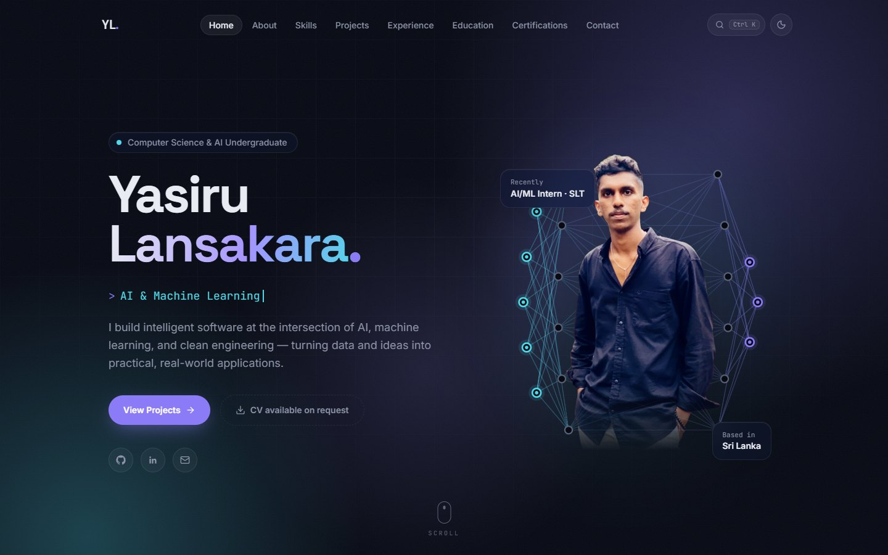
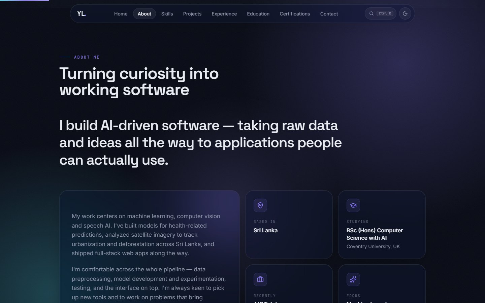
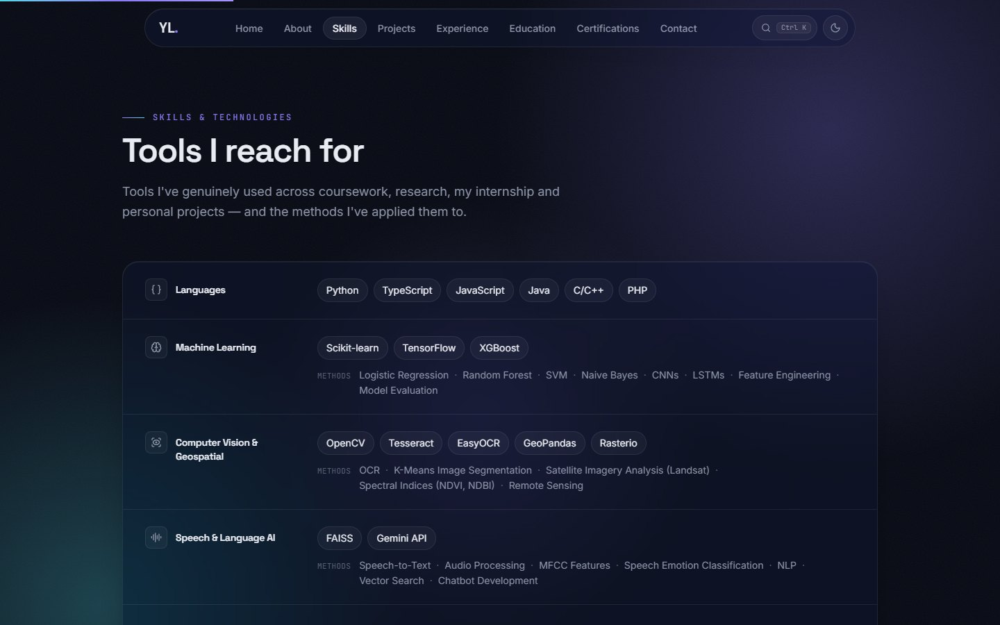
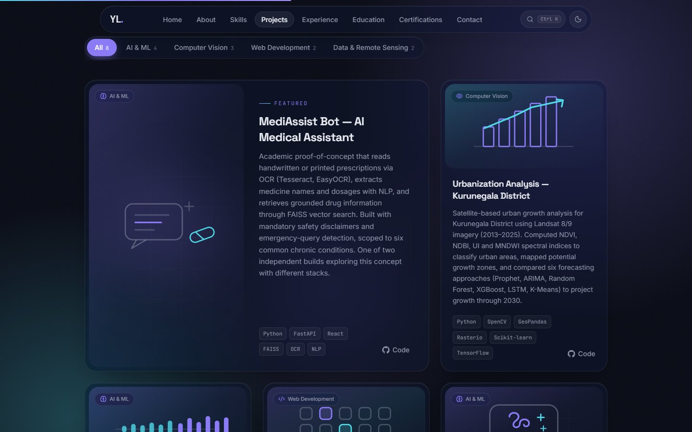
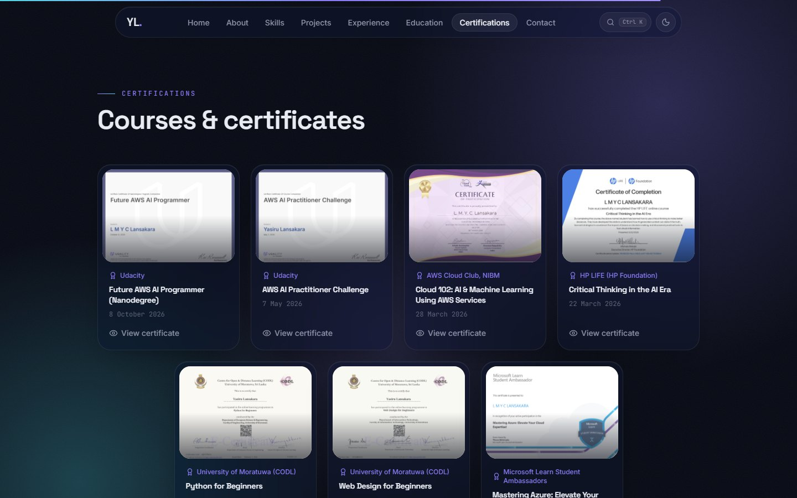
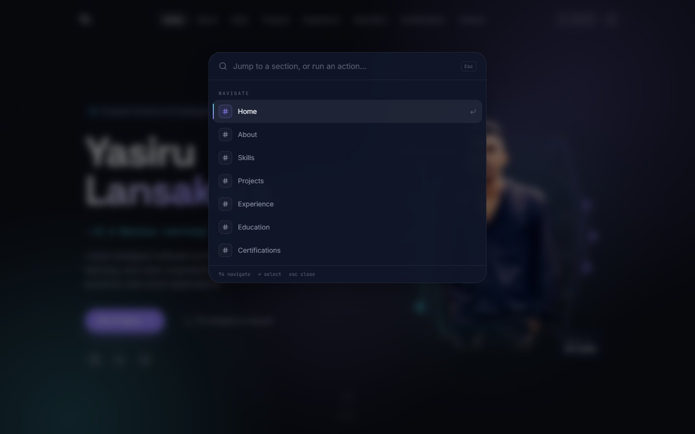
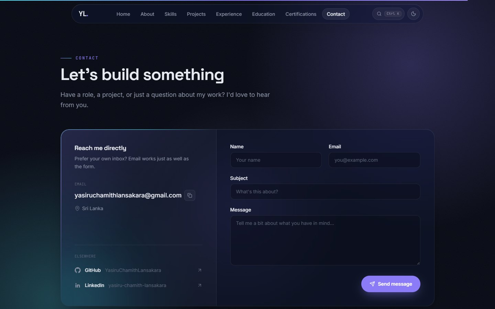
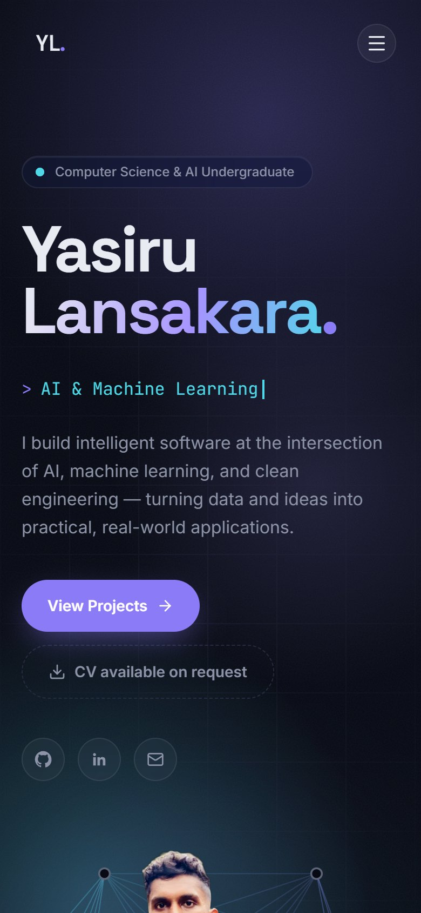
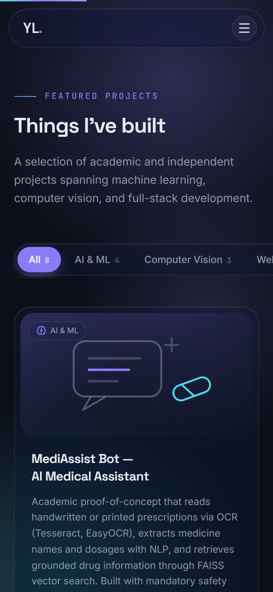
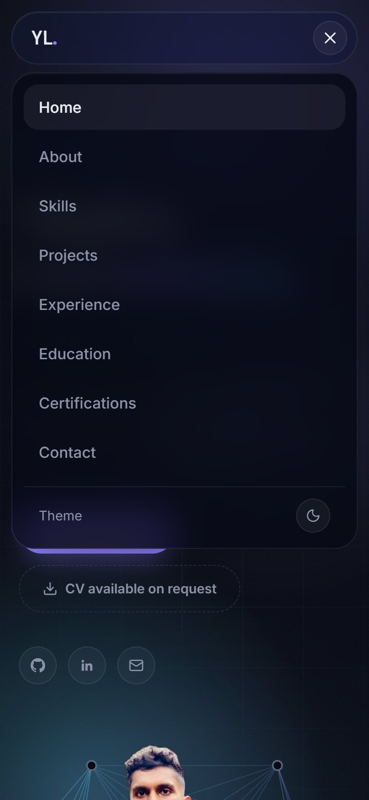

<div align="center">

<a href="https://yasiruchamithlansakara.github.io/portfolio_v2/">
  <picture>
    <source media="(prefers-color-scheme: light)" srcset="docs/screenshots/hero-light.jpg" />
    
  </picture>
</a>

# Yasiru Lansakara · Portfolio

**AI & software developer portfolio: machine learning, computer vision and full-stack projects, in one fast single-page site.**

[](https://yasiruchamithlansakara.github.io/portfolio_v2/)
[](https://github.com/YasiruChamithLansakara/portfolio_v2/actions/workflows/deploy.yml)

[](https://react.dev)
[](https://www.typescriptlang.org)
[](https://vite.dev)
[](https://tailwindcss.com)
[](https://motion.dev)

[**Live demo**](https://yasiruchamithlansakara.github.io/portfolio_v2/) ·
[Features](#features) ·
[Screenshots](#screenshots) ·
[Tech stack](#tech-stack) ·
[Getting started](#getting-started) ·
[Contact](#contact)

</div>

---

## Features

- **Refined glass design**: dark-first theme with a light mode, frosted panels, a soft animated aurora backdrop, and Space Grotesk / Inter / JetBrains Mono typography.
- **Motion with restraint**: staggered reveals, spring-based card tilt and magnetic buttons, a scroll-driven text reveal and count-up stats. All of it respects `prefers-reduced-motion`.
- **Command palette**: press <kbd>Ctrl</kbd> <kbd>K</kbd> (<kbd>⌘</kbd> <kbd>K</kbd> on macOS) to jump to any section, copy the email address, switch theme or open a profile.
- **Filterable projects**: category filter with live counts and animated re-layout, led by a wide "featured" card when the grid has room for one.
- **Certificate viewer**: each certification opens a full preview in an accessible modal.
- **Working contact form**: submits through [Formspree](https://formspree.io), with a `mailto:` fallback when no endpoint is configured.
- **Accessible by default**: semantic landmarks, a skip link, visible focus styles, full keyboard support, and focus restored when dialogs close.
- **Content-driven**: every word on the page lives in one typed file, [`src/data/portfolio.ts`](src/data/portfolio.ts).

## Screenshots

<table>
  <tr>
    <td width="50%"></td>
    <td width="50%"></td>
  </tr>
  <tr>
    <td width="50%"></td>
    <td width="50%"></td>
  </tr>
  <tr>
    <td width="50%"></td>
    <td width="50%"></td>
  </tr>
</table>

<details>
<summary><b>Mobile</b></summary>
<br />

<table>
  <tr>
    <td width="33%"></td>
    <td width="33%"></td>
    <td width="33%"></td>
  </tr>
</table>

</details>

## Tech stack

| Layer       | Tools                                                                                                     |
| ----------- | --------------------------------------------------------------------------------------------------------- |
| Framework   | [React 19](https://react.dev) with [TypeScript](https://www.typescriptlang.org)                           |
| Build       | [Vite 8](https://vite.dev)                                                                                |
| Styling     | [Tailwind CSS v4](https://tailwindcss.com): theme tokens in CSS, glass and spotlight components           |
| Animation   | [Motion for React](https://motion.dev) (successor to Framer Motion), plus CSS for ambient effects          |
| Icons       | [Lucide](https://lucide.dev), with custom SVG brand icons and project artwork                             |
| Forms       | [Formspree](https://formspree.io) (optional)                                                              |
| Quality     | [oxlint](https://oxc.rs/docs/guide/usage/linter), strict TypeScript                                       |
| Hosting     | [GitHub Pages](https://pages.github.com) via GitHub Actions                                               |

## Getting started

**Prerequisites:** Node.js 22 (or 20.19+) and npm.

```bash
git clone https://github.com/YasiruChamithLansakara/portfolio_v2.git
cd portfolio_v2
npm install
npm run dev
```

The dev server prints a local URL. Because of the GitHub Pages base path, the site is served under `/portfolio_v2/`.

### Contact form (optional)

Copy [`.env.example`](.env.example) to `.env.local` and add your form endpoint:

```bash
VITE_FORMSPREE_ENDPOINT=https://formspree.io/f/your-form-id
```

Without it, the form opens the visitor's email app instead. `.env.local` is gitignored.

### Scripts

| Command           | What it does                                    |
| ----------------- | ----------------------------------------------- |
| `npm run dev`     | Start the dev server with hot reload            |
| `npm run build`   | Type-check, then build to `dist/`               |
| `npm run preview` | Serve the production build locally              |
| `npm run lint`    | Lint with oxlint                                |

## Editing content

All content (profile, skills, projects, experience, education, certifications, stats) is in [`src/data/portfolio.ts`](src/data/portfolio.ts), typed by [`src/types/portfolio.ts`](src/types/portfolio.ts). Change the data and the layout follows; no component edits needed. Open content questions are tracked in [`TODO.md`](TODO.md).

<details>
<summary><b>Project structure</b></summary>

```
src/
  components/   UI sections and shared pieces (Hero, ProjectCard, CommandPalette, ...)
    icons/      Brand icons and per-project SVG artwork
  data/         portfolio.ts: all site content
  hooks/        Theme, section navigation, role rotator, tilt, clipboard
  lib/          Motion presets, pointer tracking, platform helpers
  types/        Shared TypeScript interfaces
public/
  images/       Profile photo and certificate previews (WebP/JPEG)
docs/
  screenshots/  Images used in this README
scripts/        One-off Node maintenance scripts (not part of the build)
  process-cutout.mjs     Frame a background-removed photo for the hero
  convert-certs.mjs      Render certificate PDFs to WebP previews
  generate-favicons.mjs  Rasterize public/favicon.svg to PNG sizes
```

</details>

## Deployment

[`.github/workflows/deploy.yml`](.github/workflows/deploy.yml) builds and publishes to GitHub Pages on every push to `main`, and can be re-run by hand from the Actions tab.

To deploy a fork:

1. **Settings → Pages → Source:** select **GitHub Actions**.
2. **Settings → Secrets and variables → Actions:** add `VITE_FORMSPREE_ENDPOINT` (optional).
3. If the repository has a different name, update `base` in [`vite.config.ts`](vite.config.ts) and the absolute URLs in [`index.html`](index.html), [`public/sitemap.xml`](public/sitemap.xml) and [`public/robots.txt`](public/robots.txt).

## Contact

<div align="center">

**Yasiru Lansakara**, Computer Science & AI undergraduate · Sri Lanka

[](mailto:yasiruchamithlansakara@gmail.com)
[](https://www.linkedin.com/in/yasiru-chamith-lansakara)
[](https://github.com/YasiruChamithLansakara)

</div>

---

<div align="center">
<sub>This repository has no open-source licence. The code is public to read, but please ask before reusing the content, photos or design.</sub>
</div>
